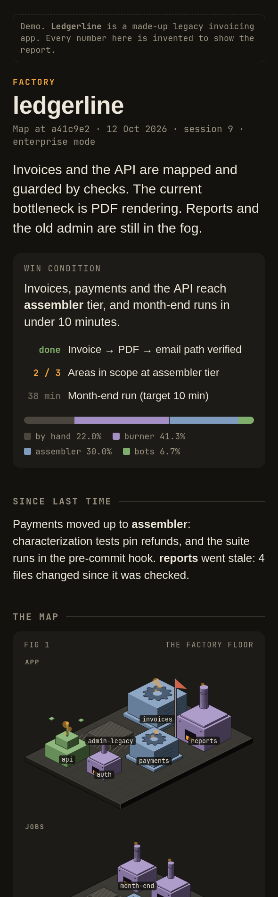

# Refactory

**Refactor a codebase like a factory: map it, understand it and automate it, one area at a time.**

Refactory (refactor + factory) is an agent skill for Claude Code, Codex, Cursor and other hosts that read `SKILL.md` files. It is built
for large and legacy codebases, where nobody left knows why things are the way they are, and where a change
can reach many teams and has to wait for a release.

It borrows the loop from factory games: explore a bit, build a bit, upgrade, explore further. You never map
everything before you start improving things. The work is real engineering: the factory words are just a shared
vocabulary.

<p align="center"></p>

## Trend up, never sledgehammer

In a big codebase a rewrite is the riskiest move there is, and a cleanup with no business reason may never ship.
So Refactory never rewrites. It improves the code in small changes that each ship safely on their own:

- **Ratchets:** checks that stop a number (lint errors, untyped files, slow queries) from getting worse, and let it
  fall over time. No behaviour change, so they ship any day.
- **Ride-alongs:** improvements prepared ahead and shipped with the feature work that touches the same area, each as
  its own reviewable change.
- **Parallel change:** expand, migrate, contract. Structure moves in steps that can stop halfway without harm.
- **Trends:** the report shows a few numbers per area over time. Success is the trend, not the size of a change.

The agent never merges, releases or turns on a flag. When a big change really is needed, it writes the case for the
people who own the decision, not the change.

## How it works

1. **Explore.** The agent maps the codebase: broad and shallow first, then deeper where it matters. Every claim
   cites a file and line, or it is marked unverified.
2. **Ask.** You ask "how does this work?" and "why is it like this?". Each question is logged. Questions show which
   areas are unclear or important, and they steer where the agent digs next. Your answers are the knowledge the code
   cannot give.
3. **Upgrade.** Each area has an **automation tier**: how much an agent may change there without asking.

   | Tier | Name      | The area has                                | Agent may                     |
   | ---- | --------- | ------------------------------------------- | ----------------------------- |
   | 0    | by hand   | no map, or no tests                         | read and map                  |
   | 1    | burner    | a verified map; tests pin today's behaviour | small changes you review      |
   | 2    | assembler | checks that run automatically               | keep-or-revert upgrades alone |
   | 3    | bots      | enforced budgets for speed, size, errors    | unattended hill climbs        |

   Upgrading an area means adding the checks that let more work run by itself. Fixing issues happens inside an
   area, at the tier it allows. The current bottleneck always goes first.

4. **Hill climb.** When a fix needs many measured attempts on one number, the factory recommends a hill climb. You
   start it with `/hillclimb <id>`: one change, one measurement, keep or revert, until it hits the target.
5. **Learn.** Corrections and feedback go into `.refactory/log.md`. Repeated corrections become rules, enforced in
   code, types, lint or tests where possible. Lessons that apply to every codebase are proposed back to this repo,
   only with your approval.
6. **Read one page.** The agents keep their own notes in whatever shape works for them. You read one page,
   `Factory.html`: the map, the bottleneck, three questions for you, recommended hill climbs, trends, ride-alongs,
   findings and upgrades.
   It is built for a phone. See the [live demo](https://gurdeepbajwa.github.io/refactory/examples/demo/Factory.html).

The win condition, the **rocket**, is yours to set: for example "invoices, payments and the API reach assembler
tier, and month-end runs in under 10 minutes".

## Install

```bash
npx skills add gurdeepbajwa/refactory
```

Or in Claude Code, as a plugin:

```text
/plugin marketplace add gurdeepbajwa/refactory
/plugin install refactory@refactory
```

Or clone it into your skills folder:

```bash
git clone https://github.com/gurdeepbajwa/refactory ~/.agents/refactory
ln -s ~/.agents/refactory/skills/* ~/.claude/skills/
```

The report check (`scripts/check-report.mjs`) needs [Playwright](https://playwright.dev). Everything else needs only
git, bash and Node 18 or newer.

## Use

```text
/refactory map this codebase
how does an invoice get sent?
/refactory what should we upgrade next?
/refactory rebuild the report
/hillclimb month-end-time
```

On the first run it creates `.refactory/` at the repo root and asks for your win condition and scope.

## What's inside

```
skills/refactory/
  SKILL.md          entry point: vocabulary, the session loop, the rules
  playbooks/        explore · questions · upgrade · report · reflect
  references/       trend-up, tiers, evidence rules, the .refactory/ layout, report.json schema
  scripts/          hotspots.sh, areas.sh, build-report.mjs, check-report.mjs
  templates/        config.md, log.md, areas.tsv, trends.tsv, ridealongs.md, hillclimb.md
skills/hillclimb/
  SKILL.md          the keep-or-revert loop for one metric
  references/       benchmark checklist
examples/demo/      a made-up legacy app's report.json and Factory.html
LEARNINGS.md        lessons merged back from real codebases
```

## Privacy

`.refactory/` lives in your repository. Nothing is sent anywhere by this skill. The reflect playbook only ever
proposes a lesson upstream after it strips project details and you approve the exact text.

## Credits

Ideas borrowed, with thanks:

- Peter Naur, [Programming as Theory Building](https://pages.cs.wisc.edu/~remzi/Naur.pdf) (1985): a program is the
  theory in its makers' heads.
- Adam Tornhill, _Your Code as a Crime Scene_: hotspots from size and change frequency.
- Michael Feathers, _Working Effectively with Legacy Code_: characterization tests.
- Sillito, Murphy and De Volder, _Questions Programmers Ask During Software Evolution Tasks_ (FSE 2006): the four
  question kinds.
- Eliyahu Goldratt, _The Goal_: work on the bottleneck. Toyota's Lean: waste types, stop the line, make wins
  stick.
- [pstack](https://github.com/cursor/plugins/tree/main/pstack) by poteto: the hill climb and benchmark discipline.
- [diagram-design](https://github.com/cathrynlavery/diagram-design): self-contained HTML and SVG, deletion first.
- [ASD-STE100 skill](https://github.com/danyuchn/asd-ste100-skill): plain, unambiguous writing for agent notes.
- Martin Fowler, preparatory refactoring ("make the change easy, then make the easy change") and the strangler fig;
  Danilo Sato, parallel change (expand, migrate, contract).
- Factorio and Minecraft, for the loop.

## License

MIT
